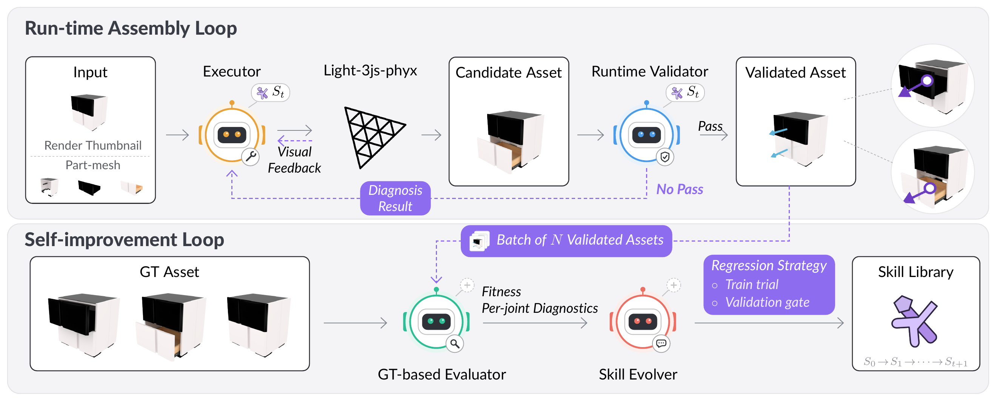

# AgentAssemble

Code for the paper **AgentAssemble: Self-Improving Agents for Articulated 3D Asset Assembly**.

[Project page](https://alaya-lab.github.io/AgentAssemble/) · [Paper](docs/assets/paper.pdf)

An LLM agent receives the separate part meshes of an articulated object, one reference image, and a
kinematic template, and it has to write the complete URDF. The procedure that the agent follows is a
*Skill*, a directory with a Markdown document and helper scripts. AgentAssemble improves this Skill from
the agent's own rollouts and needs no human edit.

- **Runtime Assembly Loop.** An *Executor* agent assembles one object in a persistent Python session with a
  frozen Assembly SDK. A *Runtime Validator* checks intermediate results without ground truth.
- **Self-Improvement Loop.** A *GT-based Evaluator* scores every predicted URDF kinematically and returns
  per-joint diagnostics. A *Skill Evolver* agent groups the failures into clusters, edits the Skill, and tests
  each edit on train objects of its cluster. A candidate Skill replaces the current one only when it wins a
  paired comparison on a separate validation split.



## Results

Test split of the ArtiAssembly evaluation subset, 40 objects with three sessions each. The Skill was
improved with `gpt-6.1-sol` only and is run unchanged under the other Executor models.

| Executor model | Fitness S0 | Fitness S9 | Pass Rate S0 (%) | Pass Rate S9 (%) | Paired fitness gain |
|---|---|---|---|---|---|
| gpt-6.1-sol | 0.474 | 0.681 | 30.0 | 52.5 | +0.207 ± 0.041 |
| claude-opus-5-5 | 0.387 | 0.552 | 18.3 | 33.3 | +0.165 ± 0.034 |
| gpt-6.1-terra | 0.316 | 0.572 | 18.3 | 39.2 | +0.256 ± 0.039 |
| gpt-6-astra | 0.568 | 0.814 | 43.3 | 71.7 | +0.246 ± 0.049 |

S0 is the seed Skill and S9 the Skill accepted in round 9. Both are in [`skills/paper`](skills/paper).

## Repository layout

```
evo/engine/        the two loops: Executor and Skill Evolver sessions, failure clusters, paired validation gate
evo/assembly_sdk/  the frozen Assembly SDK that the Executor calls
evo/oracle/        the GT-based Evaluator (check_urdf.py) and the renderers
evo/agents/        system prompts of the Skill Evolver
evo/configs/       main.yaml is the configuration of the paper
skills/paper/      the Skills of the paper: S0_seed, S3, S6, S9 and the human-curated Skill
benchmark/         object list of ArtiAssembly, the splits of the evaluation subset, the screening of the seed Skill
scripts/           experiment scripts, dataset view builders, checks of the installation
tests/             unit tests (pytest)
docs/              project page
```

## Installation

Python 3.10 or newer is required.

```bash
pip install -e ".[executor,dev]"
pytest                                  # unit tests, no model or simulator needed
```

Rendering and simulation use [Light-3js-phyx](https://github.com/dougefla/Light3jsPhyx), an engine built on
three.js and Rapier that runs in a headless browser. Its Python SDK is installed as a dependency. Build
its Node server once and point `LIGHTPHYX_CLI` at the result.

```bash
git clone https://github.com/dougefla/Light3jsPhyx && cd Light3jsPhyx
npm ci && npm run build && npx playwright install chromium
export LIGHTPHYX_CLI=$PWD/packages/server/dist/cli.js
```

Model access goes through any Responses-compatible endpoint. Put the credentials in `~/.env`.

```bash
OPENAI_API_BASE=https://openrouter.ai/api/v1
OPENROUTER_API_KEY=...
```

## Data

Set `EVO_DATASET_ROOT` to the folder of the evaluation subset. [`benchmark/README.md`](benchmark/README.md)
describes the layout, the splits, and how the task view is built from the objects.

## Reproducing the paper

```bash
export EVO_DATASET_ROOT=/path/to/artiassembly_subset

# Self-improvement, 12 rounds from the seed Skill (train 40 objects, validation gate on 40 objects)
scripts/experiments/run_main.sh

# Test split, 40 objects x 3 sessions per Skill
scripts/experiments/run_test.sh 9876 skills/paper/S0_seed skills/paper/S9

# Another Executor model
EXEC_MODEL=claude-opus-5-5 scripts/experiments/run_test.sh 9876 skills/paper/S0_seed skills/paper/S9

# Ablations: without the regression strategy, without diagnostics
scripts/experiments/run_ablation.sh noreg
scripts/experiments/run_ablation.sh score

# Paired comparison of test runs against the seed Skill
python scripts/experiments/compare_test.py runs.json runs/runs
```

Runs are written to `runs/`. `PAR` sets the number of parallel Executor sessions (default 14).
One test evaluation of a Skill costs about 25 USD with `gpt-6.1-sol` at low reasoning effort.

The same loop is available through the `evo` command (`evo train`, `evo infer`, `evo test`), which
prompts for the options and prints the command that it runs.

## License

The code and the ArtiAssembly dataset are released under the MIT License. See [LICENSE](LICENSE).
The project page in `docs/` uses the Nerfies template under CC BY-SA 4.0.

## Citation

```bibtex
@article{agentassemble2026,
  title   = {AgentAssemble: Self-Improving Agents for Articulated 3D Asset Assembly},
  author  = {Author names to be added},
  journal = {arXiv preprint},
  year    = {2026}
}
```
